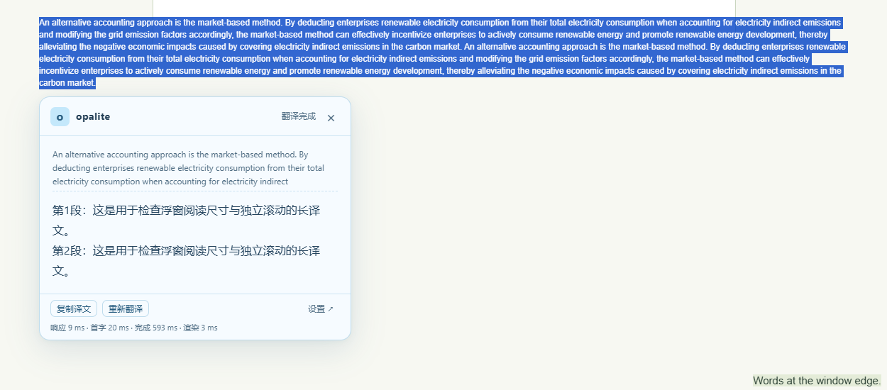

# opalite翻译

轻量的 Chrome / Edge 划词 AI 翻译扩展。使用自己的 OpenAI 兼容 API，无需后端，无需构建。

**当前版本：v1.6.0 · 需要 Chrome / Edge 141 或更新版本。**

## 名称与主题

产品名 **opalite翻译**，界面简称 **opalite**。设置页、网页浮窗、PDF 侧栏和扩展图标统一为浅天蓝色系，正文保持深蓝。

## 功能

- 网页：选中文字，按 **Alt+Shift+Y** 或右键“翻译选中内容”，在选区旁显示流式翻译浮窗。
- 原生 PDF：保留浏览器自带阅读器，选中文字后点同一个右键菜单，自动打开侧栏翻译。支持有可复制文字的在线、本地、带查询参数及无扩展名 PDF。
- 离开来源 PDF 标签页、导航或关闭文档时，取消请求并关闭侧栏。返回 PDF 不自动重开，再次右键即可翻译。
- 浮窗支持复制、重试、Esc 关闭、原文/译文独立滚动，并根据选区和窗口空间定位。首次长译文采用紧凑按钮与更充足的中文阅读区；手动拖动后的尺寸分配沿用旧版。选区覆盖大部分视口时可能仍有部分重叠。
- “浮窗可拖动”“翻译完成后点击外部关闭”两个独立开关，默认关闭。
- 会话缓存、取消旧请求、非流式兼容、连接测试和耗时反馈。

PDF 只使用右键；网页快捷键不会读取 PDF 选区。扫描件 OCR、整页翻译、密码解锁和跨域 iframe 取词不在支持范围。

## 安装与更新

1. 下载 [v1.6.0 扩展包](dist/opalite-translator-v1.6.0.zip)，解压到固定目录；或下载整个仓库。
2. Edge 打开 edge://extensions；Chrome 打开 chrome://extensions，开启开发者模式。
3. 点击“加载解压缩的扩展”，选择直接包含 manifest.json 的目录。使用整个仓库时选择 extension 文件夹。
4. 更新时覆盖原加载目录的文件，再点击扩展卡片“重新加载”，确认版本号；刷新网页并重新打开 PDF。保持原加载目录可沿用已有配置。

## API 配置

点击扩展图标进入设置，填写 **API 地址、API Key、模型名称**，保存后即可使用。

- 支持 OpenAI 兼容 **Chat Completions**，地址接受基础地址或完整 /chat/completions 地址，设置页展示最终请求地址。
- 模型名称直接填写，无需模型列表；目标语言默认简体中文，可以修改。
- 默认流式输出；接口不支持流式时可关闭。模型耗时和网络情况会影响出字速度。
- “保存并测试”会发送少量示例文字，显示实际模型及响应耗时。
- API Key 保存在扩展本地存储，不同步云端、不注入页面、不写入日志。无鉴权本地服务可留空。

快捷键可在 edge://extensions/shortcuts 或 chrome://extensions/shortcuts 修改；设置页显示当前绑定。只注册一个一级右键菜单，不需要选择浮窗或侧栏。

## 隐私与权限

仅在主动翻译时把选中文字、目标语言和翻译指令发送到所配置的 API。PDF 文件在原生阅读器中，不会作为附件上传给模型。

页面访问使用 activeTab；API 域名按需授权。使用 scripting、contextMenus、storage 和 sidePanel。没有整站自动读取、剪贴板读取、调试器权限或自建服务端。

## 开发与检查

源码为 Manifest V3 + 原生 JavaScript / HTML / CSS。运行扩展无需安装依赖。可选使用 Node.js 运行检查：

~~~sh
npm run check
npm test
~~~

测试仅使用本地模拟接口与假密钥。23 项单元测试覆盖流式解析、API 错误、缓存、选区校验、菜单自动分流及侧栏生命周期。开发阶段还在 Edge 155、Chrome 156 上分别完成了 54 项网页回归、20 项侧栏集成检查；这类交互测试不等同于所有 PDF 文件或模型服务均已验证。

- extension/：可直接加载的扩展。
- tests/：可移植的单元测试与示例页面。
- tools/：静态检查及模拟 API。
- dist/：可直接解压加载的当前版本包。
